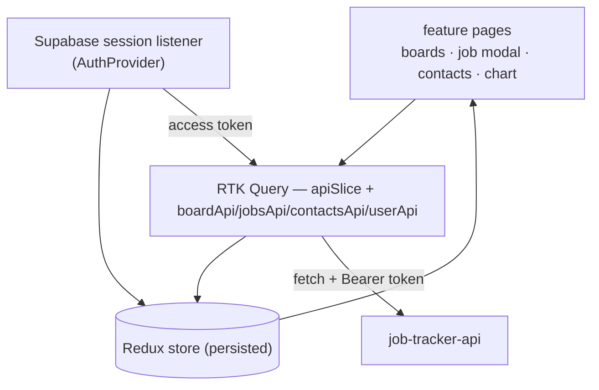

# Job Application Tracker — Web

React frontend for a Kanban-style job-search tracker: boards of columns
(Wishlist → Applied → Interview → Offer …), draggable cards for each application,
a details panel per role, and a contacts tab for the people on each application.

API: **[job-tracker-api](https://github.com/petryga/job-tracker-api)**

## Features

- **Boards** — multiple boards per account (e.g. one per search), up to ten
- **Columns & cards** — add / rename / delete columns, add cards, drag cards
  between columns and drag columns to reorder; the layout persists to the API
- **Job details** — a per-card panel: company, role, salary (auto-formatted),
  status, link with a "visit" action, free-text description
- **Contacts** — a tab on each job card plus a per-board contacts view
- **Pie chart** of applications by column, per board
- **Account** — self-service "delete everything I own"
- Auth via Supabase; runs in a no-auth local mode when Supabase isn't configured

## Stack

| | |
|---|---|
| Framework | React 19, TypeScript, Vite |
| State / data | Redux Toolkit + **RTK Query** (one injected API slice per resource), `redux-persist` |
| UI | MUI, Emotion, `@hello-pangea/dnd` for drag-and-drop |
| Auth | `@supabase/supabase-js` |
| Notifications | `react-hot-toast` |
| Tests | Vitest + Testing Library (jsdom) — ~200 tests |
| CI | GitHub Actions — lint, typecheck, tests, production build |

## Architecture

```
src/
  features/        one folder per screen (homePage, boardPage, jobModal,
                   contactsPage, chartModal, login, auth) — component + helpers + tests
  components/      shared UI (nav, header, card, list, form, modal, tab panel)
  api/             RTK Query — apiSlice (base query + auth header) plus
                   boardApi / jobsApi / contactsApi / userApi injected onto it
  reducers/        local UI slices (modal, drag state)
  lib/             supabaseClient
  store/store.ts   Redux store: API slice + UI slices, persisted
```

Auth is **decoupled from storage**: Supabase issues the identity, the API stores
all data in MongoDB keyed by the Supabase user id. The client signs in with
`@supabase/supabase-js`; `AuthProvider` tracks the session from an auth-state
listener and `RequireAuth` gates the routes (a no-op when Supabase isn't
configured). Every request through `apiSlice` attaches the Supabase access token
as a bearer header. Routes and the board view are code-split with `React.lazy`;
large vendors (Supabase, MUI, React) are split into cacheable chunks.



## Running locally

```bash
npm install
cp .env.example .env     # leave the Supabase vars blank to run without auth
npm run dev              # http://localhost:3001
```

The API ([job-tracker-api](https://github.com/petryga/job-tracker-api)) needs to
be running on `http://localhost:3000` for data to load. With the Supabase vars
blank, run the API with `AUTH_DISABLED=true`.

## Commands

| | |
|---|---|
| `npm run dev` | Vite dev server on :3001 |
| `npm run build` | `tsc` typecheck + production build to `dist/` |
| `npm run preview` | serve the production build |
| `npm test` | Vitest |
| `npm run lint` / `npm run typecheck` | ESLint / `tsc --noEmit` |

## Configuration

| Var | Required | Notes |
| --- | --- | --- |
| `VITE_BACKEND_URL` | prod only | API base URL; dev always uses `http://localhost:3000` |
| `VITE_SUPABASE_URL` | with auth | Supabase project URL — same project as the API |
| `VITE_SUPABASE_ANON_KEY` | with auth | Supabase publishable/anon key |

Both Supabase vars must be set for login to be enabled; with neither, the app
runs in no-auth mode. Deployed on Render as a static site (`npm run build`,
publish `dist/`); the API ([job-tracker-api](https://github.com/petryga/job-tracker-api))
runs on Northflank.
